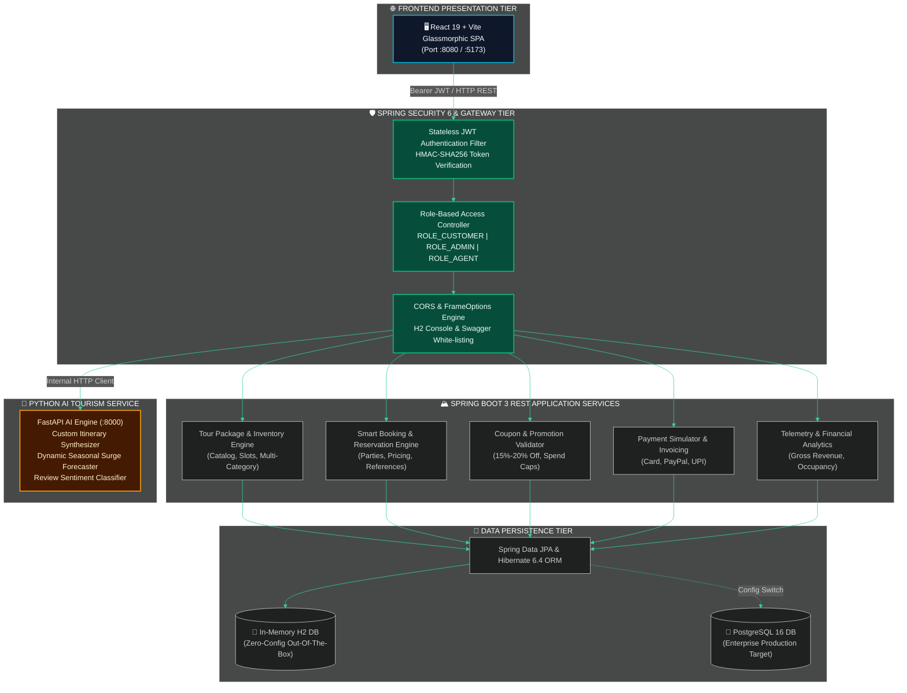
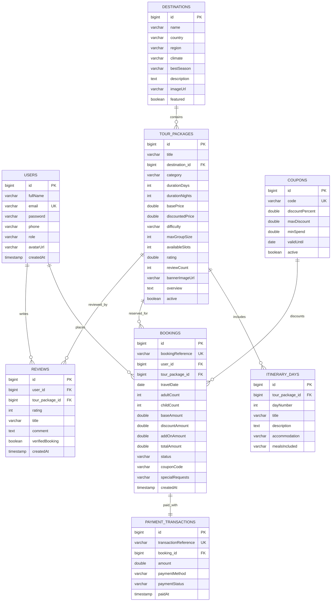

<!-- ============================================================================== -->
<!-- 🧭 TERRAVOYAGE ENTERPRISE GLOBAL EXPEDITIONS & TOURISM PLATFORM                -->
<!-- COMPLETE PRODUCTION TECHNICAL SPECIFICATION & COMPREHENSIVE ARCHITECTURE MANUAL-->
<!-- ============================================================================== -->

<p align="center">
  
</p>

<p align="center">
  <a href="https://github.com/Gaurav-Khaladkar/Terravoyage-tourism-platform">
    
  </a>
</p>

<p align="center">
  
  
  
  
  
  
  
</p>

---

## 📑 Comprehensive Table of Contents
<div align="center">
  <a href="#-project-overview"><b>Overview</b></a> •
  <a href="#-languages-and-technologies-breakdown"><b>Languages & Tech</b></a> •
  <a href="#-system-architecture"><b>Architecture</b></a> •
  <a href="#-database-schema--domain-model"><b>Data Models</b></a> •
  <a href="#-definite-functions--code-breakdown"><b>Definite Functions</b></a> •
  <a href="#-complete-rest-api-catalog"><b>REST APIs</b></a> •
  <a href="#-ai-microservice-specification"><b>AI Microservice</b></a> •
  <a href="#-frontend-component-architecture"><b>Frontend Components</b></a> •
  <a href="#-pre-configured-demo-credentials"><b>Credentials</b></a> •
  <a href="#-execution-guide"><b>Run Guide</b></a>
</div>

---

## 🧭 Project Overview

**TerraVoyage** is an industry-grade, polyglot enterprise tourism, expedition, and luxury vacation booking management platform. It combines a robust **Java 17 / Spring Boot 3.2** RESTful backend, a high-performance **React 19 & Vite 6** glassmorphic web application, and an asynchronous **Python FastAPI AI Trip Intelligence microservice**.

### Key Capabilities:
- **Expedition Discovery & Multi-Filtering:** Dynamic package catalog filtered by category (`LUXURY`, `ADVENTURE`, `CULTURAL`, `SAFARI`, `BEACH_WELLNESS`), difficulty (`EASY`, `MODERATE`, `CHALLENGING`), destinations, and price sliders.
- **Day-by-Day Interactive Itinerary:** Day-wise schedules with accommodation details and included meal plans.
- **Reservation & Pricing Engine:** Automated party pricing with adult rates, 30% child discount, optional VIP airport chauffeur, and medical trip protection.
- **Coupon Discount Engine:** Real-time percentage discount calculations with spend caps (`EARLYBIRD15`, `WANDER2026`, `GLOBETREK10`).
- **Simulated Payment Gateway:** Multi-channel payments (Credit Card, PayPal, UPI) with zero-friction status updates (`PENDING` ➔ `CONFIRMED`).
- **Digital Boarding Pass & Travel Voucher:** Real-time boarding pass with barcode simulation, download/print functionality, and confetti celebration.
- **Backoffice Telemetry Dashboard:** Financial metrics (Gross Revenue, Confirmed/Pending Bookings, Active Inventory) and customer booking status management.
- **AI Travel Copilot:** Customized itinerary planner, weather-adaptive packing advice, and seasonal dynamic pricing forecasting.

---

## 💻 Languages and Technologies Breakdown

### 1. Languages Employed
| Language | Implementation Scope | Primary Usage |
| :--- | :--- | :--- |
| **Java 17 LTS** | Backend Core | Enterprise REST APIs, Spring Security 6, JPA Repositories, Domain Entities, Business Services |
| **JavaScript (ES6+) / JSX** | Frontend Client | React 19 SPA, Vite build pipeline, asynchronous API layer, interactive UI state |
| **Python 3.11** | AI Microservice | FastAPI trip planning engine, dynamic pricing algorithm, NLP sentiment classifier |
| **SQL / JPQL** | Data Access | Relational queries, aggregate financial functions (`SUM`, `COUNT`), index optimizations |
| **HTML5 & CSS3** | Presentation Tier | Semantic markup, Obsidian & Emerald Glassmorphism design system, flexbox, CSS grid |
| **YAML / Markdown** | Configuration & Docs | Spring Boot properties, Docker Compose orchestration, OpenAPI 3 annotations |

---

### 2. Technologies & Frameworks Matrix
| Category | Framework / Library | Version | Technical Purpose |
| :--- | :--- | :--- | :--- |
| **Backend Framework** | Spring Boot | `3.2.3` | Standalone enterprise microservice container |
| **Security Framework** | Spring Security | `6.2.2` | Filter-based authentication, RBAC authorization, CORS & CSRF control |
| **JWT Engine** | JJWT (`io.jsonwebtoken`) | `0.11.5` | Stateless HMAC-SHA256 token issuance & signature validation |
| **ORM / Data Access** | Spring Data JPA / Hibernate | `6.4.4.Final` | Object-Relational Mapping, entity lifecycle, JPQL queries |
| **Dev Database** | H2 Database | Embedded | Zero-configuration in-memory DB with web console (`/h2-console`) |
| **Prod Database** | PostgreSQL / MySQL | `16` / `8.3` | Production ACID-compliant relational persistence |
| **API Documentation** | Springdoc OpenAPI / Swagger | `2.3.0` | Automated OpenAPI 3.0 specification & interactive UI (`/swagger-ui.html`) |
| **Validation** | Jakarta Bean Validation | JSR-380 | Request payload constraints (`@NotNull`, `@Email`, `@Min`, `@Future`) |
| **Frontend Framework** | React | `19.0.0` | Component-based reactive UI rendering |
| **Frontend Tooling** | Vite | `6.2.0` | Ultra-fast ESM bundler & API proxy configuration |
| **UI Iconography** | Lucide React | `1.57.0` | Lightweight SVG icons |
| **Visual Effects** | Canvas-Confetti | `1.9.4` | Particle explosion animation upon booking confirmation |
| **AI Microservice** | FastAPI | `0.110.0` | High-performance asynchronous Python REST API |
| **Data Validation** | Pydantic | `2.6.0` | Python type enforcement and JSON serialization |
| **ASGI Web Server** | Uvicorn | `0.28.0` | Lightning-fast ASGI web server for Python |
| **Containerization** | Docker & Docker Compose | `3.8` | Multi-container multi-stage production deployments |

---

## 🏛️ System Architecture



---

## 💾 Database Schema & Domain Model

The platform uses a normalized relational model managed through JPA annotations:



---

## ⚙️ Definite Functions & Code Breakdown

### 1. Spring Boot Backend Services (`backend/src/main/java`)

#### 🛡️ `JwtTokenProvider.java`
- `generateToken(Authentication authentication)`: Constructs a compact JWT signed with HMAC-SHA256 (`Keys.hmacShaKeyFor`), embedding `userId`, `fullName`, and `roles` with a 24-hour expiration window.
- `getUsernameFromJwt(String token)`: Parses claims body to extract user email subject.
- `validateToken(String authToken)`: Validates signature integrity, expiry, and structure without throwing unhandled exceptions.

#### 🔑 `AuthService.java`
- `login(AuthRequest request)`: Authenticates credentials via Spring's `AuthenticationManager`, generates JWT token, and returns user identity metadata.
- `register(RegisterRequest request)`: Enforces unique email constraint, hashes password using BCrypt (`BCryptPasswordEncoder`), assigns default role `ROLE_CUSTOMER`, and generates initial authentication session.

#### 🏔️ `TourPackageService.java`
- `getAllPackages()`: Retrieves all active packages mapped to DTO representations.
- `getFeaturedPackages()`: Fetches top 6 expeditions sorted descending by rating.
- `searchPackages(keyword, category, difficulty, destinationId, minPrice, maxPrice)`: Executes multi-parameter JPQL query filtering across destination title, country name, categories, difficulty grades, and price boundaries.
- `createPackage(TourPackageDTO dto)`: Persists new expedition package and cascades creation of day-by-day `ItineraryDay` entities.
- `updatePackage(Long id, TourPackageDTO dto)`: Updates package details, duration, pricing, and updates itinerary list.
- `deletePackage(Long id)`: Performs soft deactivation (`active = false`).
- `mapToDTO(TourPackage pkg)`: Bidirectional conversion decoupling JPA persistence entities from REST API payloads.

#### 📋 `BookingService.java`
- `createBooking(UserPrincipal currentUser, BookingRequestDTO dto)`:
  - Verifies requested slot availability (`availableSlots >= adults + children`).
  - Computes base rate: `(adultCount * unitPrice) + (childCount * unitPrice * 0.70)`.
  - Calculates selected add-ons: VIP transfer ($60) + Travel insurance ($35/person).
  - Validates and applies promotional coupon code.
  - Generates unique reference code: `TV-YYYY-XXXXXX`.
  - Atomically decrements remaining package slots and sets booking status to `CONFIRMED`.
- `getUserBookings(UserPrincipal currentUser)`: Retrieves all bookings for the logged-in customer sorted by creation date.
- `cancelBooking(String reference, UserPrincipal currentUser)`: Validates ownership or admin privileges, transitions status to `CANCELLED`, and releases slots back to tour inventory.
- `updateBookingStatus(String reference, BookingStatus status)`: Admin endpoint to advance booking lifecycle (`CONFIRMED`, `COMPLETED`, `CANCELLED`).

#### 🏷️ `CouponService.java`
- `validateCoupon(String code, Double baseAmount)`: Evaluates promo code existence, active status, expiration date, and minimum spend requirements. Calculates percentage discount up to the coupon's maximum discount cap.

#### 💳 `PaymentService.java`
- `processPayment(UserPrincipal currentUser, PaymentIntentDTO dto)`: Simulates real-time card/PayPal authorization, generates unique transaction ID (`TXN-timestamp-XXXX`), binds transaction to booking, and marks status as `SUCCESS`.

#### 📊 `AnalyticsService.java`
- `getDashboardStats()`: Aggregates total platform revenue (`sum(totalAmount)` where status is confirmed/completed), total booking counts, breakdown by category, and active inventory count.

---

### 2. Frontend Application (`frontend/src/`)

#### 🌐 `api.js`
- `login(email, password)`: POSTs to `/api/v1/auth/login`, stores JWT token and user profile in `localStorage`.
- `register(fullName, email, password, phone, role)`: Registers new traveler profile.
- `getPackages(params)`: Calls `/api/v1/packages` with query string parameters for live filtering.
- `validateCoupon(code, baseAmount)`: Instant asynchronous coupon validation.
- `createBooking(bookingData)`: Posts reservation payload with `Authorization: Bearer <token>` header.
- `checkout(paymentData)`: Simulates instant payment processing.
- `getMyBookings()`: Loads traveler's active reservations.
- `cancelBooking(reference)`: Cancels reservation and triggers slot release.
- `getAdminAnalytics()`: Loads telemetry stats for admin dashboard.
- `getAIRecommendation(preferences)`: Invokes AI Copilot endpoint with travel style and budget.

#### ⚛️ UI Components
- `Navbar.jsx`: Sticky glassmorphism header with live brand logo, AI Copilot trigger, role-based navigation links, and 1-click sign out.
- `HeroSection.jsx`: Cinematic hero banner with multi-tab category pills, destination keyword input, trek difficulty selector, and budget slider.
- `PackageCard.jsx`: High-res imagery with hover zoom, discount badges, review averages, and direct "Itinerary" and "Book" buttons.
- `TourModal.jsx`: Modal displaying day-by-day accordion schedule, stay/meal plans, inclusions/exclusions, and verified review submission form.
- `BookingModal.jsx`: 3-step interactive booking wizard:
  - *Step 1:* Date picker, guest counters (with 30% child discount), add-on options, promo coupon validation, and live price calculator.
  - *Step 2:* Simulated checkout with payment method tabs (Credit Card, PayPal, UPI) and 256-bit encryption indicator.
  - *Step 3:* Digital Boarding Pass voucher with simulated barcode, traveler details, print button, and confetti particle burst.
- `MyBookingsModal.jsx`: Customer reservation hub allowing travelers to view active bookings, cancel trips, and download tickets.
- `AdminDashboardModal.jsx`: Administrative backoffice displaying gross revenue KPIs, occupancy rates, and reservation status management table.
- `AICopilotModal.jsx`: AI expedition architect allowing travelers to input budget, companion type, and travel style to receive custom plans.
- `AuthModal.jsx`: Sign In / Register dialog with **1-Click Instant Demo Login Buttons** for Admin and Traveler.

---

### 3. Python AI Microservice (`ai-service/app.py`)

- `POST /api/ai/plan-itinerary`: Accepts travel destination, duration in days, budget, and travel style. Generates structured day-by-day morning/afternoon/evening activities, estimated daily spend, packing advice, and sustainability scores.
- `POST /api/ai/predict-demand`: Calculates dynamic seasonal pricing multipliers factoring in peak summer/winter months and current occupancy rates.
- `POST /api/ai/sentiment-analysis`: Analyzes customer feedback to detect sentiment (`POSITIVE`/`NEGATIVE`), confidence score, and detected praise keywords.

---

## 📡 Complete REST API Catalog

All 22 endpoints are documented with OpenAPI 3.0 and testable via Swagger UI at `http://localhost:8080/swagger-ui.html`.

### Authentication & Users
| Method | Endpoint | Access | Request Body | Description |
| :---: | :--- | :---: | :--- | :--- |
| `POST` | `/api/v1/auth/login` | Public | `{"email": "...", "password": "..."}` | Authenticate and obtain JWT token |
| `POST` | `/api/v1/auth/register` | Public | `{"fullName": "...", "email": "...", "password": "...", "phone": "..."}` | Register a new customer account |
| `GET` | `/api/v1/auth/me` | User | None (Bearer Token) | Get profile of currently logged-in user |

### Tour Packages & Catalog
| Method | Endpoint | Access | Query Parameters | Description |
| :---: | :--- | :---: | :--- | :--- |
| `GET` | `/api/v1/packages` | Public | `keyword`, `category`, `difficulty`, `destinationId`, `maxPrice` | Search and filter tour packages |
| `GET` | `/api/v1/packages/featured` | Public | None | Retrieve top 6 highest-rated expeditions |
| `GET` | `/api/v1/packages/{id}` | Public | None | Get full package itinerary and details |
| `POST` | `/api/v1/packages` | Admin | `TourPackageDTO` | Create a new tour package |
| `PUT` | `/api/v1/packages/{id}` | Admin | `TourPackageDTO` | Update an existing tour package |
| `DELETE` | `/api/v1/packages/{id}` | Admin | None | Soft delete / deactivate tour package |

### Destinations
| Method | Endpoint | Access | Query Parameters | Description |
| :---: | :--- | :---: | :--- | :--- |
| `GET` | `/api/v1/destinations` | Public | None | Get all world destinations with climate & seasons |
| `GET` | `/api/v1/destinations/featured` | Public | None | Get featured destinations |
| `GET` | `/api/v1/destinations/{id}` | Public | None | Get destination by ID |
| `POST` | `/api/v1/destinations` | Admin | `Destination` | Create a new destination |

### Bookings & Reservations
| Method | Endpoint | Access | Request Body | Description |
| :---: | :--- | :---: | :--- | :--- |
| `POST` | `/api/v1/bookings` | User | `{"tourPackageId": 1, "travelDate": "2026-11-01", "adultCount": 2, "childCount": 0, "couponCode": "EARLYBIRD15"}` | Create expedition reservation |
| `GET` | `/api/v1/bookings/my` | User | None (Bearer Token) | List bookings belonging to current user |
| `GET` | `/api/v1/bookings/{ref}` | User | None (Bearer Token) | Retrieve booking details and digital pass |
| `POST` | `/api/v1/bookings/{ref}/cancel`| User | None (Bearer Token) | Cancel reservation and release slots |

### Payments & Checkout
| Method | Endpoint | Access | Request Body | Description |
| :---: | :--- | :---: | :--- | :--- |
| `POST` | `/api/v1/payments/checkout` | User | `{"bookingReference": "TV-2026-X89J", "amount": 2490.0, "paymentMethod": "CREDIT_CARD"}` | Simulate payment transaction |

### Coupons & Promotions
| Method | Endpoint | Access | Query Parameters | Description |
| :---: | :--- | :---: | :--- | :--- |
| `GET` | `/api/v1/coupons/validate` | Public | `code=EARLYBIRD15&baseAmount=2000` | Validate promo code and calculate discount |

### Reviews & Ratings
| Method | Endpoint | Access | Request Body | Description |
| :---: | :--- | :---: | :--- | :--- |
| `GET` | `/api/v1/reviews/package/{id}` | Public | None | List reviews for a specific package |
| `GET` | `/api/v1/reviews/recent` | Public | None | List most recent global reviews |
| `POST` | `/api/v1/reviews` | User | `{"tourPackageId": 1, "rating": 5, "title": "...", "comment": "..."}` | Submit verified traveler review |

### Admin & Telemetry
| Method | Endpoint | Access | Request Body | Description |
| :---: | :--- | :---: | :--- | :--- |
| `GET` | `/api/v1/admin/analytics` | Admin | None (Bearer Token) | Retrieve platform revenue and booking stats |
| `GET` | `/api/v1/admin/bookings` | Admin | None (Bearer Token) | List all customer bookings across platform |
| `PUT` | `/api/v1/admin/bookings/{ref}/status` | Admin | `{"status": "CONFIRMED"}` | Update booking lifecycle status |

### AI Trip Copilot
| Method | Endpoint | Access | Request Body | Description |
| :---: | :--- | :---: | :--- | :--- |
| `POST` | `/api/v1/ai/recommend` | Public | `{"travelStyle": "LUXURY", "maxBudget": 3500, "companionType": "COUPLE"}` | Generate custom AI expedition plan |

---

## 👥 Pre-Configured Demo Credentials

The web application login modal includes **1-Click Instant Demo Login Buttons**:

| Role | Email Address | Password | Permissions & Capabilities |
| :--- | :--- | :--- | :--- |
| **Administrator** | `admin@terravoyage.com` | `admin123` | Full backoffice telemetry, revenue KPIs, booking status manager, package CRUD |
| **Verified Traveler** | `traveler@terravoyage.com` | `traveler123` | Search expeditions, customize bookings, apply promo coupons, download vouchers, post reviews |
| **Mountain Guide** | `guide@terravoyage.com` | `guide123` | Assigned expedition manifest access |

---

## 🏃 Execution Guide

### Option 1: Unified Single-Command Run (Recommended)
Because the React frontend is compiled directly into Spring Boot's static folder (`backend/src/main/resources/static`), running the Spring Boot backend serves the **entire full-stack application** on port 8080:

```powershell
cd C:\Users\hp\.gemini\antigravity-ide\scratch\terravoyage-tourism-platform\backend
mvn spring-boot:run
```

- 🌐 **Web Application Portal:** [http://localhost:8080](http://localhost:8080)
- 📖 **Interactive Swagger UI:** [http://localhost:8080/swagger-ui.html](http://localhost:8080/swagger-ui.html)
- 🗄️ **H2 Database Console:** [http://localhost:8080/h2-console](http://localhost:8080/h2-console)  
  *(JDBC URL: `jdbc:h2:mem:terravoyagedb`, User: `sa`, Password: empty)*

---

### Option 2: Frontend Development with Hot-Reloading
```powershell
# Terminal 1: Start Spring Boot REST API
cd backend
mvn spring-boot:run

# Terminal 2: Start Vite Dev Server (with automatic /api proxy)
cd frontend
npm run dev
```
Open **[http://localhost:5173](http://localhost:5173)** in your browser.

---

### Option 3: Full-Stack Docker Compose Deployment
```bash
docker-compose up --build
```
Orchestrates PostgreSQL 16 (`:5432`), Spring Boot (`:8080`), Python FastAPI (`:8000`), and Nginx React frontend (`:80`).

---

<p align="center">
  
</p>

<p align="center">
  <b>TerraVoyage Global Expeditions Ltd.</b> • Engineered with Spring Boot 3, React 19 &amp; FastAPI
</p>
