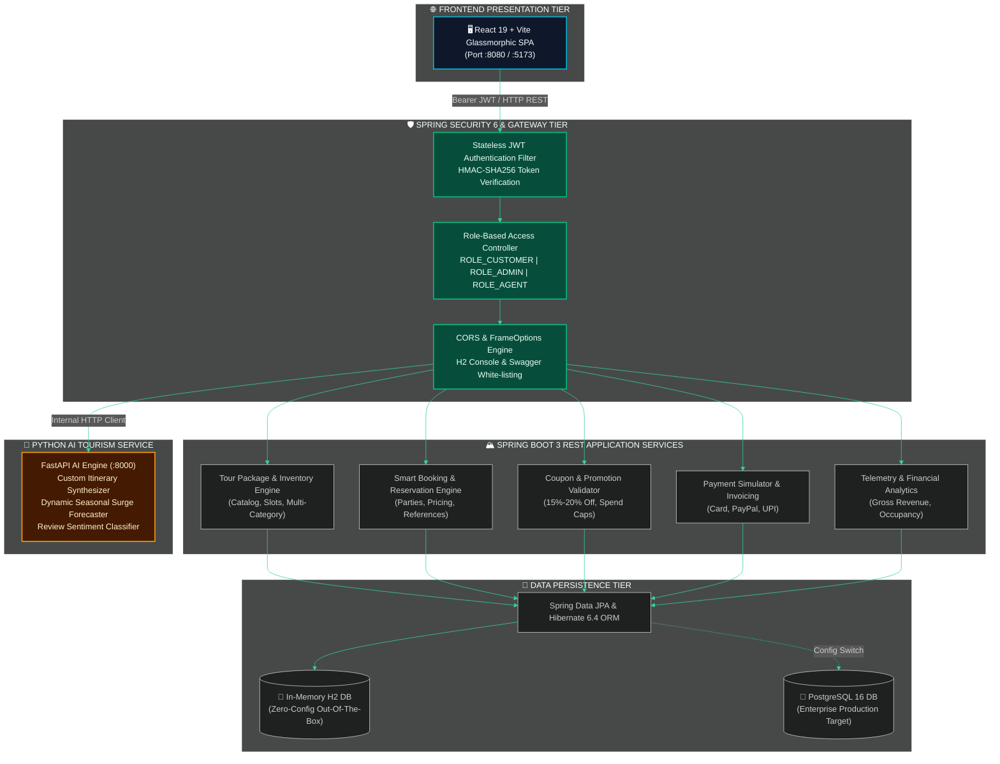

<!-- ============================================================================== -->
<!-- 🧭 TERRAVOYAGE ENTERPRISE GLOBAL EXPEDITIONS & TOURISM PLATFORM                -->
<!-- ============================================================================== -->

<p align="center">
  
</p>

<p align="center">
  <a href="https://github.com/terravoyage/tourism-platform">
    
  </a>
</p>

<p align="center">
  
  
  
  
  
  
  
</p>

---

## 📑 Quick Navigation
<div align="center">
  <a href="#-system-architecture"><b>Architecture</b></a> •
  <a href="#-key-industry-features"><b>Core Features</b></a> •
  <a href="#-technology-stack-matrix"><b>Tech Stack</b></a> •
  <a href="#-pre-configured-demo-credentials"><b>Credentials</b></a> •
  <a href="#-live-application-access"><b>Live URLs</b></a> •
  <a href="#-step-by-step-execution-guide"><b>Getting Started</b></a> •
  <a href="#-core-rest-api-catalog"><b>REST APIs</b></a> •
  <a href="#-directory-structure"><b>Project Structure</b></a>
</div>

---

## 🏛️ System Architecture

<div align="center">
  
  
  
</div>



---

## 🌟 Highlight Features Showcase

<table>
  <tr>
    <td width="50%">
      <h3 align="center">🏔️ Handcrafted Tour Expeditions</h3>
      <p align="center">
        
      </p>
      <ul>
        <li><b>Dynamic Catalog:</b> Swiss Alps, Bali Temples, Kyoto Sakura, Serengeti Safari, and Amalfi Catamaran.</li>
        <li><b>Trek Difficulty:</b> Easy, Moderate, and Challenging peak expeditions.</li>
        <li><b>Itinerary Timelines:</b> Day-by-Day morning, afternoon, and evening schedules with boutique stays.</li>
        <li><b>Verified Ratings:</b> Aggregate star scores with verified traveler review badges.</li>
      </ul>
    </td>
    <td width="50%">
      <h3 align="center">🎟️ Smart Reservation & Digital Passes</h3>
      <p align="center">
        
      </p>
      <ul>
        <li><b>Family & Group Pricing:</b> Adult rates + automatic <b>30% child discount</b>.</li>
        <li><b>Add-on Services:</b> VIP Chauffeur Transfer (+$60) & Medical Protection (+$35/guest).</li>
        <li><b>Real-Time Slot Deduction:</b> Automated inventory tracking to prevent overbooking.</li>
        <li><b>Digital Boarding Pass:</b> Print-ready voucher with VIP reference and confetti celebration.</li>
      </ul>
    </td>
  </tr>
  <tr>
    <td width="50%">
      <h3 align="center">🏷️ Enterprise Coupon Engine</h3>
      <p align="center">
        
      </p>
      <ul>
        <li><b>Live Validation:</b> Evaluates minimum spend, expiry dates, and percentage savings instantly.</li>
        <li><code>EARLYBIRD15</code> — <b>15% Off</b> (Min spend $500, max discount $400)</li>
        <li><code>WANDER2026</code> — <b>20% Off</b> (Min spend $1,000, max discount $600)</li>
        <li><code>GLOBETREK10</code> — <b>10% Off</b> (Min spend $200, max discount $200)</li>
      </ul>
    </td>
    <td width="50%">
      <h3 align="center">🤖 AI Trip Copilot & Analytics</h3>
      <p align="center">
        
      </p>
      <ul>
        <li><b>AI Trip Planner:</b> Generates custom schedules based on companion type and budget.</li>
        <li><b>Smart Packing Assistant:</b> AI-generated weather-adaptive gear checklists.</li>
        <li><b>Dynamic Pricing Forecasts:</b> Demand surge calculation based on seasonal occupancy.</li>
        <li><b>Backoffice Telemetry:</b> Real-time gross revenue, confirmed bookings, and occupancy KPIs.</li>
      </ul>
    </td>
  </tr>
</table>

---

## 🛠️ Technology Stack Matrix

```
┌────────────────────────────────────────────────────────────────────────┐
│                        TERRAVOYAGE TECH STACK                          │
├───────────────────┬──────────────────────────────────┬─────────────────┤
│ Component         │ Framework / Library              │ Version         │
├───────────────────┼──────────────────────────────────┼─────────────────┤
│ Backend Core      │ Java Development Kit (JDK)       │ 17 LTS / 24     │
│ Framework         │ Spring Boot Web & REST           │ 3.2.3           │
│ Security          │ Spring Security 6 & JJWT         │ 0.11.5          │
│ Persistence       │ Spring Data JPA / Hibernate      │ 6.4.4.Final     │
│ Database (Dev)    │ In-Memory H2 Database Console    │ Latest          │
│ Database (Prod)   │ PostgreSQL / MySQL Connector/J   │ 16 / 8.3        │
│ API Documentation │ Springdoc OpenAPI / Swagger UI   │ 2.3.0           │
│ Frontend SPA      │ React 19 & Vite 6 (ESM)          │ 19.0 / 6.2      │
│ UI & Icons        │ Lucide React & Canvas-Confetti   │ 1.57 / 1.9      │
│ Styling           │ Obsidian Glassmorphism CSS       │ Native / Fluid  │
│ AI Microservice   │ Python 3.11, FastAPI, Pydantic   │ 0.110.0         │
│ Containerization  │ Docker & Docker Compose          │ 3.8 Multi-Stage │
└───────────────────┴──────────────────────────────────┴─────────────────┘
```

---

## 👥 Pre-Configured Demo Credentials

<div align="center">
  <p><i>The authentication modal includes <b>1-Click Instant Demo Login Buttons</b> for immediate evaluation:</i></p>
</div>

| Badge | Role | Email Address | Password | Permissions & Access Scope |
| :---: | :--- | :--- | :--- | :--- |
|  | **Administrator** | `admin@terravoyage.com` | `admin123` | Backoffice analytics, gross revenue KPIs, booking status manager, tour package CRUD |
|  | **Verified Traveler** | `traveler@terravoyage.com` | `traveler123` | Search expeditions, customize bookings, apply promo coupons, download vouchers, post reviews |
|  | **Mountain Guide** | `guide@terravoyage.com` | `guide123` | Assigned expedition manifest access |

---

## 🚀 Live Application Access

The unified full-stack application is currently running live in the background:

<div align="center">

| Service | Direct Link | Description |
| :--- | :--- | :--- |
| **🌐 Full-Stack Web Portal** | [**http://localhost:8080**](http://localhost:8080) | Interactive tourism booking platform & digital passes |
| **📖 Swagger OpenAPI UI** | [**http://localhost:8080/swagger-ui.html**](http://localhost:8080/swagger-ui.html) | Interactive REST API tester and schema explorer |
| **📡 OpenAPI 3.0 Raw JSON** | [**http://localhost:8080/v3/api-docs**](http://localhost:8080/v3/api-docs) | Machine-readable API specifications (Postman ready) |
| **🗄️ H2 Database Console** | [**http://localhost:8080/h2-console**](http://localhost:8080/h2-console) | In-memory database console (`JDBC: jdbc:h2:mem:terravoyagedb`, User: `sa`, Password: empty) |

</div>

---

## 🏃 Step-by-Step Execution Guide

### Option 1: Unified Single-Command Run (Spring Boot + Built React Frontend)

The React frontend has been built directly into Spring Boot's `src/main/resources/static` directory. Starting Spring Boot serves the **entire application** on a single port:

```powershell
# Navigate to the backend directory
cd C:\Users\hp\.gemini\antigravity-ide\scratch\terravoyage-tourism-platform\backend

# Launch the unified server
mvn spring-boot:run
```

Open your browser to: **[http://localhost:8080](http://localhost:8080)**

---

### Option 2: Active Development Mode (Vite Hot-Reloading + Backend API)

To make live UI updates with instant hot-reloading:

```powershell
# Terminal 1: Run Spring Boot REST API
cd backend
mvn spring-boot:run

# Terminal 2: Run Vite Dev Server with hot-reload & proxy
cd frontend
npm run dev
```

Open your browser to: **[http://localhost:5173](http://localhost:5173)**  
*(Vite proxies all `/api` calls directly to `http://localhost:8080`)*

---

### Option 3: Full-Stack Docker Compose Deployment

To orchestrate PostgreSQL 16, Spring Boot backend, Python AI service, and Nginx frontend in isolated containers:

```bash
docker-compose up --build
```

---

## 📡 Core REST API Catalog

<details open>
<summary><b>🔍 Click to Expand REST API Endpoint Matrix (22 Endpoints)</b></summary>
<br/>

| Method | Endpoint | Authorization | Description | Sample Response |
| :---: | :--- | :---: | :--- | :---: |
|  | `/api/v1/auth/login` | Public | Authenticate user & issue JWT token | `AuthResponse` |
|  | `/api/v1/auth/register` | Public | Register new customer account | `AuthResponse` |
|  | `/api/v1/auth/me` | User | Get profile details of current user | `UserPrincipal` |
|  | `/api/v1/packages` | Public | Search packages (keyword, category, price, difficulty) | `List<TourPackageDTO>` |
|  | `/api/v1/packages/featured` | Public | Retrieve top 6 highest-rated expeditions | `List<TourPackageDTO>` |
|  | `/api/v1/packages/{id}` | Public | Get full package itinerary and inclusions | `TourPackageDTO` |
|  | `/api/v1/packages` | Admin | Create a new expedition tour package | `TourPackageDTO` |
|  | `/api/v1/packages/{id}` | Admin | Update an existing tour package | `TourPackageDTO` |
|  | `/api/v1/packages/{id}` | Admin | Deactivate an expedition package | `ApiResponse<Void>` |
|  | `/api/v1/destinations` | Public | Get all world destinations with climate & seasons | `List<Destination>` |
|  | `/api/v1/destinations/featured` | Public | Get top featured destinations | `List<Destination>` |
|  | `/api/v1/coupons/validate` | Public | Validate promo code (`code`, `baseAmount`) | `CouponValidationDTO` |
|  | `/api/v1/bookings` | User | Reserve an expedition and calculate total | `BookingResponseDTO` |
|  | `/api/v1/bookings/my` | User | List bookings belonging to current user | `List<BookingResponseDTO>` |
|  | `/api/v1/bookings/{ref}` | User | Retrieve digital boarding pass voucher | `BookingResponseDTO` |
|  | `/api/v1/bookings/{ref}/cancel`| User | Cancel booking reservation & refund | `BookingResponseDTO` |
|  | `/api/v1/payments/checkout` | User | Simulate secure multi-channel payment | `PaymentTransaction` |
|  | `/api/v1/reviews/package/{id}` | Public | List verified reviews for a package | `List<ReviewDTO>` |
|  | `/api/v1/reviews` | User | Publish verified review and update rating avg | `ReviewDTO` |
|  | `/api/v1/admin/analytics` | Admin | Retrieve platform telemetry & revenue metrics | `DashboardStatsDTO` |
|  | `/api/v1/admin/bookings` | Admin | List all platform customer bookings | `List<BookingResponseDTO>` |
|  | `/api/v1/admin/bookings/{ref}/status` | Admin | Update booking status (`CONFIRMED`, `COMPLETED`, `CANCELLED`) | `BookingResponseDTO` |
|  | `/api/v1/ai/recommend` | Public | AI Travel Copilot custom plan & packing tips | `AIRecommendation` |

</details>

---

## 📁 Directory Structure

```text
terravoyage-tourism-platform/
├── 📄 docker-compose.yml                     # Multi-service container orchestration
├── 📄 README.md                              # This animated documentation
│
├── 📂 backend/                               # Spring Boot 3.2.3 Java Backend
│   ├── 📄 pom.xml                            # Maven build descriptor (Java 17, Security, JPA)
│   ├── 📄 Dockerfile                         # Multi-stage container build
│   └── 📂 src/main/
│       ├── 📂 java/com/terravoyage/tourism/
│       │   ├── ☕ TourismPlatformApplication.java
│       │   ├── 📂 domain/                    # JPA Entities (TourPackage, Booking, Destination, etc.)
│       │   ├── 📂 repository/                # Data Repositories with custom JPQL queries
│       │   ├── 📂 service/                   # Business logic, coupon engine, booking workflow
│       │   ├── 📂 controller/                # REST Controllers (22 endpoints)
│       │   ├── 📂 dto/                       # Request & Response Data Transfer Objects
│       │   ├── 📂 security/                  # JWT Provider, Auth Filter, SecurityConfig
│       │   ├── 📂 config/                    # Swagger OpenAPI config & Data Initializer
│       │   └── 📂 exception/                 # Global Exception Handler (RFC 7807)
│       └── 📂 resources/
│           ├── 📄 application.yml            # Spring configuration (H2, JWT, Swagger)
│           └── 📂 static/                    # Built React frontend assets (HTML, CSS, JS)
│
├── 📂 frontend/                              # React 19 + Vite 6 Modern Web App
│   ├── 📄 package.json                       # React, Vite, Lucide, Canvas-Confetti
│   ├── 📄 vite.config.js                     # Proxy configuration & static build target
│   ├── 📄 index.html                         # Typography & viewport setup
│   └── 📂 src/
│       ├── 📄 main.jsx                       # React root entrypoint
│       ├── 📄 App.jsx                        # Application shell & state orchestrator
│       ├── 📄 index.css                      # Obsidian glassmorphic design system
│       ├── 📄 api.js                         # API Client with JWT authorization handling
│       └── 📂 components/                    # Modular components
│           ├── ⚛️ Navbar.jsx                 # Glass navbar with user session & role badges
│           ├── ⚛️ HeroSection.jsx             # Cinematic hero & multi-filter search console
│           ├── ⚛️ PackageCard.jsx             # Tour card with discount tags & highlights
│           ├── ⚛️ DestinationExplorer.jsx     # Visual continent & climate cards
│           ├── ⚛️ TourModal.jsx               # Day-by-day itinerary & verified reviews
│           ├── ⚛️ BookingModal.jsx            # 3-step booking wizard with ticket pass
│           ├── ⚛️ MyBookingsModal.jsx         # Traveler reservation registry & cancellations
│           ├── ⚛️ AdminDashboardModal.jsx     # Telemetry charts & booking management
│           ├── ⚛️ AICopilotModal.jsx          # AI trip planner & packing assistant
│           └── ⚛️ AuthModal.jsx               # Sign In / Register with 1-click demo logins
│
└── 📂 ai-service/                            # Python FastAPI AI Microservice
    ├── 🐍 app.py                             # Itinerary planner, dynamic pricing & sentiment API
    ├── 📄 requirements.txt                   # FastAPI, Pydantic, Uvicorn
    └── 📄 Dockerfile                         # Python container specification
```

---

<p align="center">
  
</p>

<p align="center">
  <b>TerraVoyage Global Expeditions Ltd.</b> • Engineered with Spring Boot 3 &amp; React 19
</p>
